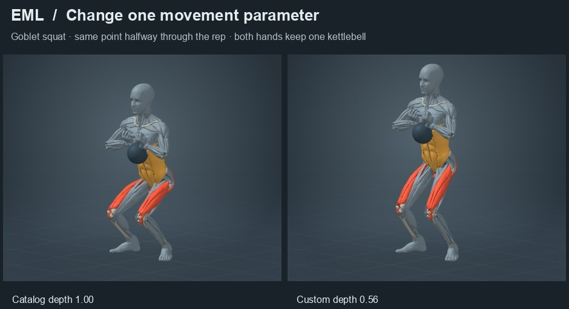

# Exercise Markup Language · v1.1

EML describes how to demonstrate an exercise on an articulated anatomy model. An author supplies the starting pose, equipment, motions, contacts, phase timing, repetition policy and muscle roles. Built-in and user-defined exercises use the same document format and solver. Version 1.1 measures wrist, elbow and knee motion, ground clearance and intersections between free weights and the body. An author can require a specific direction, grip clearance or contact with a finite support surface. [Posture rules and examples](docs/posture.md)

**[Read the specification](docs/specification.md)** · **[Author a new movement](docs/authoring.md)** · **[Machine-readable interface](interface.json)** · **[Browse the 108 exercises](exercises/)**



The reference implementation includes the [anatomy dummy](anatomy/README.md), a local interactive [viewer](viewer/), the JSON Schema, reusable posture and motion definitions, and a gym equipment registry. Equipment instances have named, adjustable sockets for grips, supports and machine attachments.

## Try it

Use Python 3.11 or later from the repository root.

```sh
python3 -m venv .venv
. .venv/bin/activate
python -m pip install -r requirements.txt
python -m eml validate exercises/goblet-squat.json
python -m eml validate examples/paused-goblet-look-left.json --set depth=0.65 --set stance-width=0.42
python -m eml compile examples/diagonal-reach.json --fps 18 -o out/reach.json
python -m viewer
```

For an installable CLI and library, run `python -m pip install .` from the checkout. The resulting `eml` command includes the registries, 108 recipes and portable anatomy buffers. The Blender master and interactive viewer are available in the source checkout.

The viewer displays the bundled mesh and serves assets locally. Choose a catalog exercise or open your own JSON file. A structurally valid raw file can be previewed with per-frame findings. The CLI rejects a failed posture check when compiling. To check every catalog entry and see diagnostics in machine-readable form, run `python -m eml catalog -o out/report.json`.

## Author at different levels

One action can coordinate the hips, knees, ankles and trunk. A recipe can combine that action with another, override just one joint axis, or supply an independent hand target while requiring both feet to stay planted. In [the parameterized goblet squat](examples/paused-goblet-look-left.json), a single depth parameter changes the squat, a timed phase holds its bottom position, and a partial head override turns the dummy to the left. The hands continue to grip the same kettlebell. [Diagonal reach](examples/diagonal-reach.json) adds a movement with a new ID and its own local definitions.

Applications and authoring tools can obtain the 1.1 interface with `python -m eml interface`. It includes the schema, rig names, muscles, pose and motion definitions, equipment socket coordinates and default posture profile. Its tested setup map pairs starting poses with compatible motions. Ground entries also include complete portable contact templates for a planted press, quadruped reach or bear step. [Compatible setups and support templates](docs/upper-motion-setups.json)

The required `eml` field selects the schema, pose and motion definitions, equipment geometry, and contact solver behavior. Published 1.0 documents still resolve against their original vocabulary. Use `python -m eml interface --version 1.0` to inspect their definitions. To upgrade a document, set its version to 1.1, validate at each authored parameter range, and review the solved movement. [Version and migration rules](docs/specification.md#versions-and-migration)

## Renderers and collaboration

The [Metal preview adapter](docs/native.md) produces animation tracks and a review workspace for the existing iOS wrapper. The language and its anatomy profile can be used independently of the wrapper or Simple Trainer. [Contribution guide](CONTRIBUTING.md) · [Conformance and evidence](docs/conformance.md) · [Anatomy licenses](anatomy/ATTRIBUTION.md)
